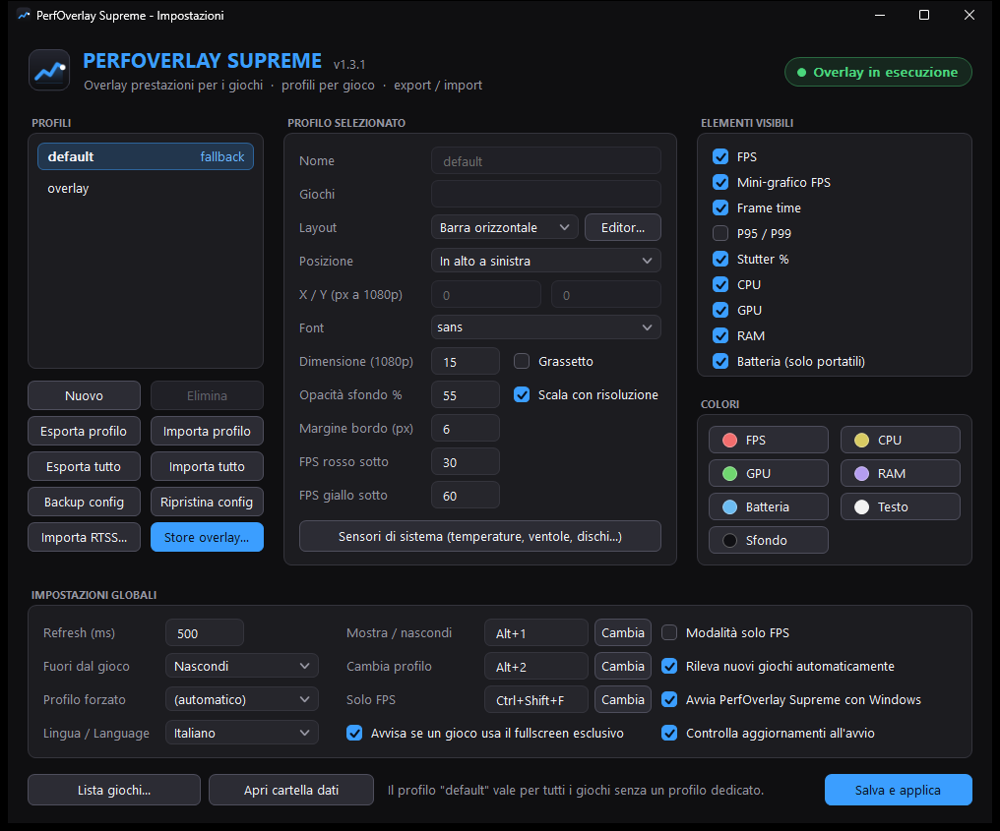
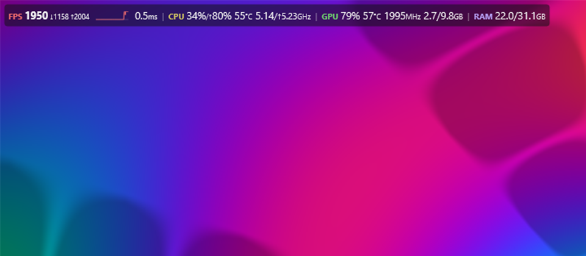

# PerfOverlay Supreme

[](https://github.com/TheBlackSide243/perfoverlay-supreme/releases/latest)
[](https://github.com/TheBlackSide243/perfoverlay-supreme/releases)
[](https://github.com/TheBlackSide243/perfoverlay-supreme/actions/workflows/build.yml)
[](#download-and-usage)
[](LICENSE)

🇮🇹 [Italiano](README.md) · 🇬🇧 **English**

**In-game performance overlay for Windows 10/11.** It shows FPS with a mini graph, frame time, 1% lows, CPU, GPU, RAM, temperatures and any system sensor on top of your game. It starts with a Steam-like style, which you can reshape in a RivaTuner-style editor. It can also use RTSS OverlayEditor presets directly, including advanced ones such as *TroyMetrics Benchmark Overlays*.

It is a single file, `PerfOverlaySupreme.exe`. There is no installer, and **nothing is injected into games**.

**[⬇ Download the latest version](https://github.com/TheBlackSide243/perfoverlay-supreme/releases/latest)**

**Settings**: profiles, layout, visible items, colors, hotkeys and language in a single resizable window (Italian UI shown; English is available).



**Overlay** on top of the built-in test scene:



## Features

- **FPS without hooks:**
  - FPS and frame time come from Windows ETW `Present` events (DirectX 9/10/11/12, Vulkan, OpenGL);
  - it also computes P95/P99, 1% and 0.1% lows, and stutter.
- **Separate overlay window:**
  - transparent, click-through, and never takes focus;
  - rendered with D3D11 + DirectComposition + Direct2D/DirectWrite.
- **Per-game profiles:**
  - games are detected automatically (heuristics and auto-learning);
  - the games list can be filled from your Steam, Epic and GOG libraries.
- **Layout editor** in RTSS style:
  - one layout per aspect ratio (16:9, 16:10, 21:9, 32:9, 4:3);
  - zoom and grid snapping;
  - adapts to any resolution.
- **RTSS presets (`.ovl` / `.ovx`):**
  - a rendering engine for OverlayEditor presets: formulas, `<IF>` conditions, graphs, bar charts, animated and tinted sprites, and the preset's own fonts;
  - simple presets can be edited in the editor.
- **Overlay store:**
  - six built-in base overlays;
  - community RTSS overlays downloaded from their authors' GitHub repositories;
  - built-in GitHub search.
- **System sensors:**
  - built in: CPU per core, full NVIDIA GPU data via NVML, disks (including SSD temperature), network and battery;
  - card VRAM and the VRAM used by the game alone;
  - optional: HWiNFO, or [LibreHardwareMonitor](https://github.com/LibreHardwareMonitor/LibreHardwareMonitor), which the app can download in one click for CPU temperature.
- **Exclusive fullscreen notice**: when a game uses it (the overlay can't show there) a notification suggests borderless mode.
- **Built-in DirectX 11/12 test scene**, so you can try the overlay without launching a game.
- **English or Italian UI**: pick it in Settings › "Lingua / Language". The first time it follows the Windows language.
- **In-app updates**: when a new version is out, an "Update to vX.Y.Z" button appears at the top of the settings. The exe is downloaded from GitHub, verified (SHA-256) and replaced, then settings and overlay reopen by themselves.

## Download and usage

1. Download `PerfOverlaySupreme.exe` from [Releases](../../releases), or [build it](#building).
2. Double-click it. The overlay starts as administrator, which reading FPS requires, and an icon appears next to the clock.
3. To open the settings, double-click the exe again or right-click the tray icon and choose Settings. The settings cover profiles, the editor, sensors, the store and the UI language.

| Hotkey | Action |
|---|---|
| Ctrl+Shift+O | show / hide |
| Ctrl+Shift+P | cycle profiles |
| Ctrl+Shift+F | FPS only |

Hotkeys can be changed in the settings.

| Command line | Effect |
|---|---|
| *(none)* | start the overlay, or open the settings if it is already running |
| `--settings` | settings |
| `--test [dx11]` | DirectX 12 (or 11) test scene |
| `--import-rtss "file.ovx" [profile]` | import an RTSS preset |

The full user guide (in Italian) is in [docs/GUIDA.md](docs/GUIDA.md).

## Building

Requirements:
- Visual Studio 2022 or Build Tools, with the *Desktop development with C++* workload (MSVC x64 + Windows SDK);
- CMake ≥ 3.21.

The first configure downloads [nlohmann/json](https://github.com/nlohmann/json), which is header-only.

```bash
cmake -S src -B src/build -A x64
```

```bash
cmake --build src/build --config Release
```

The executable is written to `src/build/bin/Release/PerfOverlaySupreme.exe`.

On Windows you can also run `Ricompila PerfOverlay Supreme.bat`. It closes the running overlay, builds, and copies the exe to the repository root.

The architecture is described in [docs/ARCHITETTURA.md](docs/ARCHITETTURA.md) (in Italian).

## Anti-cheat

PerfOverlay Supreme does not inject DLLs, does not read or write game memory, and does not hook game functions. It only uses public Windows APIs (ETW, Performance Counters, DXGI, NVML) and a transparent window, the same kind of technique PresentMon uses. Some competitive games still forbid third-party overlays, so **checking the game's terms is the user's responsibility.**

## Known limitations

- The overlay is not visible in *exclusive* fullscreen. Use "borderless window" mode (the app warns you with a notification).
- Reflex/PresentMon latency values in RTSS presets show N/A.
- CPU temperature needs HWiNFO or LibreHardwareMonitor, because Windows does not expose it without a driver.
- Full GPU data is only available on NVIDIA (through NVML). AMD and Intel GPUs need HWiNFO or LibreHardwareMonitor.

## Credits

- [nlohmann/json](https://github.com/nlohmann/json), MIT license.
- RTSS presets and store overlays belong to their respective authors. They are downloaded from the authors' repositories and are not included in this project.
- RivaTuner Statistics Server, HWiNFO, LibreHardwareMonitor, Steam and NVIDIA are trademarks of their respective owners. This project is not affiliated with any of them.

## License

[MIT](LICENSE)
