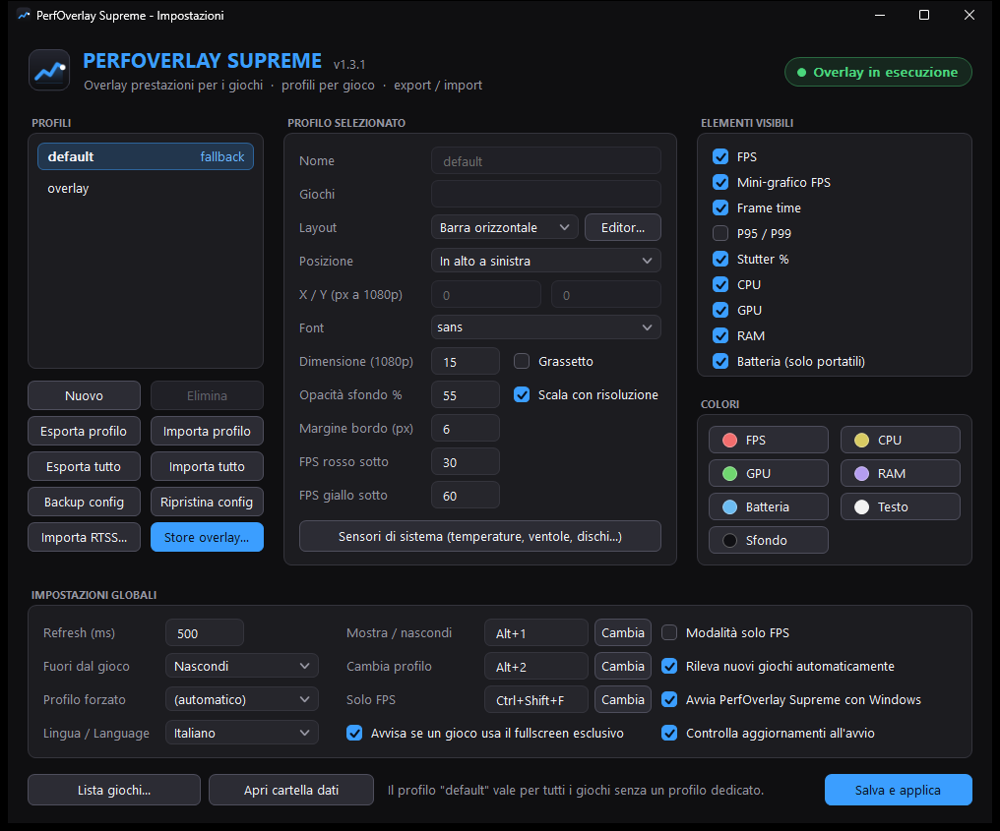
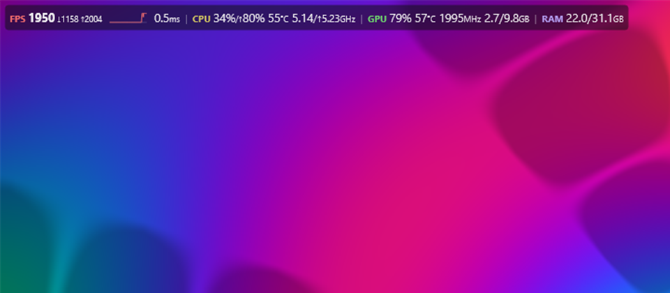

# PerfOverlay Supreme

[](https://github.com/TheBlackSide243/perfoverlay-supreme/releases/latest)
[](https://github.com/TheBlackSide243/perfoverlay-supreme/releases)
[](https://github.com/TheBlackSide243/perfoverlay-supreme/actions/workflows/build.yml)
[](#download-e-uso)
[](LICENSE)

🇮🇹 **Italiano** · 🇬🇧 [English](README.en.md)

**Overlay delle prestazioni in-game per Windows 10/11**: FPS con mini-grafico, frame time, 1% low, CPU, GPU, RAM, temperature e qualsiasi sensore di sistema, sopra al gioco. Parte con uno stile simile a quello di Steam; poi puoi modificarlo in un editor in stile RivaTuner oppure usare direttamente i preset dell'OverlayEditor di RTSS, compresi quelli avanzati come *TroyMetrics Benchmark Overlays*.

Un solo file, `PerfOverlaySupreme.exe`, senza installazione e **senza iniettare nulla nei giochi**.

**[⬇ Scarica l'ultima versione](https://github.com/TheBlackSide243/perfoverlay-supreme/releases/latest)**

**Impostazioni**: profili, layout, elementi visibili, colori, hotkey e lingua in un'unica finestra, ridimensionabile.



**Overlay** sopra la scena di prova integrata:



## Funzioni

- **FPS senza hook**:
  - frame time e FPS dagli eventi ETW `Present` di Windows (DirectX 9/10/11/12, Vulkan, OpenGL);
  - statistiche: P95/P99, 1% e 0.1% low, stutter.
- **Overlay in finestra separata**:
  - trasparente, *click-through*, non prende mai il focus;
  - disegnato con D3D11 + DirectComposition + Direct2D/DirectWrite.
- **Profili per gioco**:
  - rilevamento automatico dei giochi, con euristica e auto-apprendimento;
  - lista giochi con import dalle librerie Steam, Epic e GOG.
- **Editor del layout** in stile RTSS: un layout per ogni formato (16:9, 16:10, 21:9, 32:9, 4:3), zoom e griglia; si adatta a qualsiasi risoluzione.
- **Preset RTSS (`.ovl` / `.ovx`)**:
  - motore per l'OverlayEditor: formule, condizioni `<IF>`, grafici, barchart, sprite animati e colorati, font del preset;
  - preset semplici modificabili nell'editor.
- **Store overlay**: sei overlay base più gli overlay RTSS pubblicati su GitHub dai loro autori (scaricati dai repository originali), con ricerca integrata.
- **Sensori di sistema**:
  - integrati: CPU per core, GPU NVIDIA completa via NVML, dischi con temperatura SSD, rete, batteria;
  - VRAM della scheda e VRAM occupata dal solo gioco;
  - opzionali: HWiNFO, oppure [LibreHardwareMonitor](https://github.com/LibreHardwareMonitor/LibreHardwareMonitor) scaricabile con un clic per la temperatura CPU.
- **Avviso fullscreen esclusivo**: se un gioco lo usa (lì l'overlay non si vede) arriva una notifica che consiglia la modalità senza bordi.
- **Scena di prova DirectX 11/12** integrata, per provare l'overlay senza avviare un gioco.
- **Interfaccia in italiano o inglese**: si sceglie in Impostazioni › "Lingua / Language". La prima volta segue la lingua di Windows.
- **Aggiornamento dall'app**: quando esce una nuova versione compare il pulsante "Aggiorna a vX.Y.Z" in alto nelle impostazioni. L'exe viene scaricato da GitHub, verificato (SHA-256) e sostituito, poi impostazioni e overlay si riaprono da soli.

## Download e uso

1. Scarica `PerfOverlaySupreme.exe` dalla pagina [Releases](../../releases). In alternativa [compilalo](#compilare).
2. Doppio clic: l'overlay si avvia come amministratore (serve per gli FPS) e compare l'icona vicino all'orologio.
3. Doppio clic di nuovo, oppure tasto destro sull'icona › Impostazioni: profili, editor, sensori, store.

| Hotkey | Azione |
|---|---|
| Ctrl+Shift+O | mostra / nascondi |
| Ctrl+Shift+P | cambia profilo |
| Ctrl+Shift+F | solo FPS |

Le hotkey si cambiano nelle impostazioni.

| Riga di comando | Effetto |
|---|---|
| *(nessun argomento)* | avvia l'overlay, oppure apre le impostazioni se è già attivo |
| `--settings` | impostazioni |
| `--test [dx11]` | scena di prova DirectX 12 (o 11) |
| `--import-rtss "file.ovx" [profilo]` | importa un preset RTSS |

La guida completa è in [docs/GUIDA.md](docs/GUIDA.md).

## Compilare

Requisiti:

- Visual Studio 2022 o Build Tools, con il workload *Sviluppo di applicazioni desktop con C++* (MSVC x64 + Windows SDK);
- CMake ≥ 3.21.

La prima configurazione scarica [nlohmann/json](https://github.com/nlohmann/json), una libreria di soli header.

```bash
cmake -S src -B src/build -A x64
```

```bash
cmake --build src/build --config Release
```

L'eseguibile finisce in `src/build/bin/Release/PerfOverlaySupreme.exe`. Su Windows c'è anche lo script `Ricompila PerfOverlay Supreme.bat`: chiude l'overlay, compila e copia l'exe nella cartella principale.

Per l'architettura e la struttura del codice vedi [docs/ARCHITETTURA.md](docs/ARCHITETTURA.md).

## Anti-cheat

PerfOverlay Supreme non inietta DLL, non legge né scrive la memoria dei giochi e non ne aggancia le funzioni. Usa solo API pubbliche di Windows (ETW, Performance Counters, DXGI, NVML) e una finestra trasparente, lo stesso tipo di tecnica di PresentMon. Alcuni giochi competitivi vietano comunque gli overlay di terze parti: **verificare i termini del gioco è responsabilità dell'utente.**

## Limiti noti

- Nel fullscreen *esclusivo* l'overlay non si vede: usa "Finestra senza bordi" (l'app te lo segnala con una notifica).
- Le latenze Reflex/PresentMon dei preset RTSS mostrano N/A.
- La temperatura della CPU richiede HWiNFO o LibreHardwareMonitor, perché Windows non la espone senza un driver.
- La GPU completa è supportata su NVIDIA (NVML). Per AMD e Intel servono HWiNFO o LibreHardwareMonitor.

## Crediti

- [nlohmann/json](https://github.com/nlohmann/json), licenza MIT.
- I preset RTSS e gli overlay dello store appartengono ai rispettivi autori: vengono scaricati dai loro repository e non sono inclusi in questo progetto.
- RivaTuner Statistics Server, HWiNFO, LibreHardwareMonitor, Steam e NVIDIA sono marchi dei rispettivi proprietari. Questo progetto non è affiliato a nessuno di loro.

## Licenza

[MIT](LICENSE)
