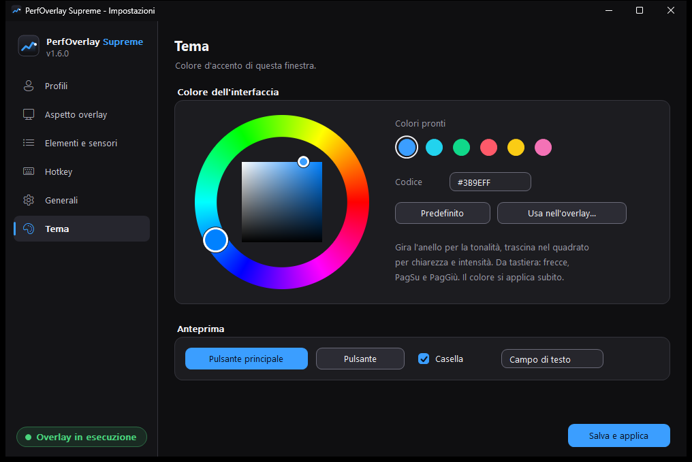
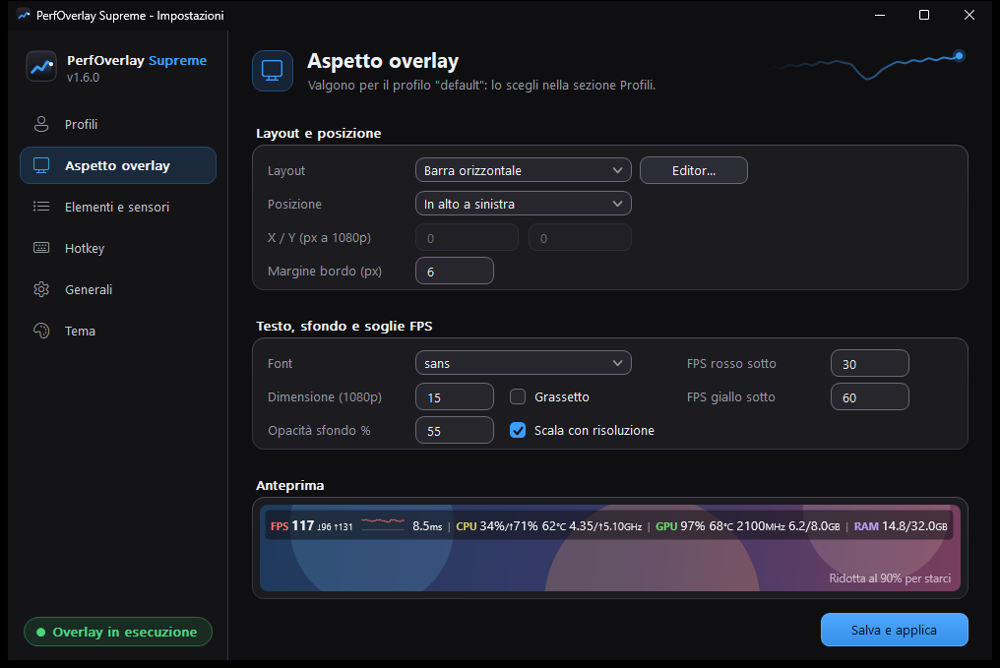
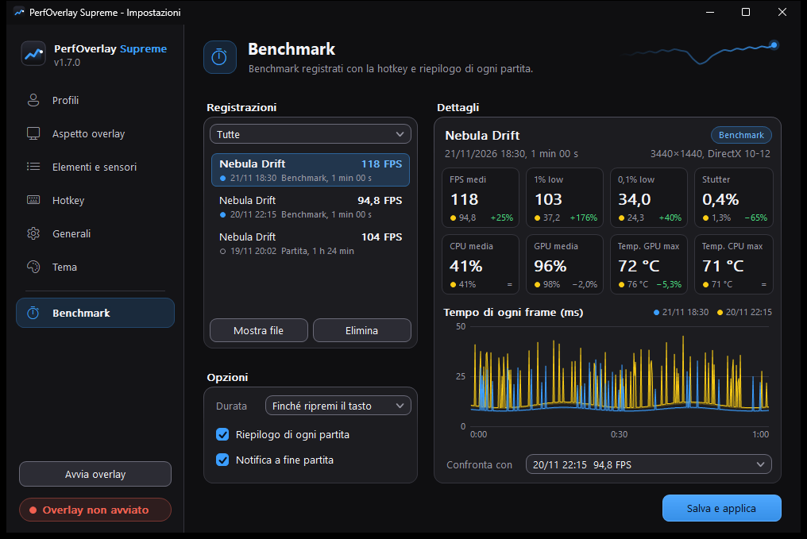

# Guida di PerfOverlay Supreme

## Indice

- [Avvio e menu](#avvio-e-menu)
- [Quando appare l'overlay](#quando-appare-loverlay)
- [Profili e overlay sul desktop](#profili-e-overlay-sul-desktop)
- [Store overlay](#store-overlay)
- [Preset RTSS (.ovx / .ovl)](#preset-rtss-ovx--ovl)
- [Overlay TroyMetrics e preset RTSS avanzati](#overlay-troymetrics-e-preset-rtss-avanzati)
- [Layout libero (editor in stile RTSS)](#layout-libero-editor-in-stile-rtss)
- [Sensori di sistema](#sensori-di-sistema)
- [Temperatura CPU](#temperatura-cpu)
- [Prova dell'overlay (DirectX 11 / 12)](#prova-delloverlay-directx-11--12)
- [Che cosa limita gli FPS, frame generati e grafico del frame time](#che-cosa-limita-gli-fps-frame-generati-e-grafico-del-frame-time)
- [Hotkey](#hotkey)
- [Benchmark e riepilogo delle partite](#benchmark-e-riepilogo-delle-partite)
- [Lingua](#lingua)
- [Aggiornamenti](#aggiornamenti)
- [Amministratore e FPS](#amministratore-e-fps)
- [Dati e log](#dati-e-log)
- [Limiti](#limiti)

## Avvio e menu

Tutto è in un solo file, `PerfOverlaySupreme.exe`: overlay, impostazioni, editor, store e finestra di prova.

- **Doppio clic**: avvia l'overlay. Chiede l'amministratore, che serve per gli FPS. Se l'overlay è già attivo, apre le **impostazioni**.
- **Finestra delle impostazioni**: a sinistra la barra delle sezioni (Profili, Aspetto overlay, Elementi e sensori, Hotkey, Generali, Tema e, staccata dalle altre, Benchmark), a destra la sezione scelta. In fondo alla barra ci sono lo stato dell'overlay e, quando serve, "Avvia overlay" e "Aggiorna a vX.Y.Z"; "Salva e applica" è sempre in basso a destra. La finestra si può ridimensionare e massimizzare e tutto il contenuto scala con lei; all'apertura si adatta allo schermo e resta nitida anche su un monitor con scala diversa.
- **Tema**: la sezione Tema cambia il colore d'accento della finestra. Si sceglie con la ruota colori (anello per la tonalità, quadrato per chiarezza e intensità; da tastiera frecce e PagSu/PagGiù), con uno dei sei colori pronti o scrivendo il codice (es. `#22D3EE`). Il colore si applica subito e resta con "Salva e applica"; "Predefinito" torna al blu. Un colore troppo scuro viene schiarito quanto basta per restare leggibile. Sotto la ruota, il riquadro "Anteprima" mostra un pulsante principale, un pulsante normale, una casella e un campo di testo con il colore scelto: si possono provare col mouse e non cambiano niente. "Usa nell'overlay..." dà lo stesso colore a un elemento dell'overlay (FPS, CPU, GPU, RAM, Batteria o Testo) nel profilo selezionato.

  
- **Anteprima dell'overlay**: in fondo alla sezione Aspetto overlay c'è una finta scena di gioco con sopra l'overlay, disegnato come quello vero ma con valori d'esempio. Cambia subito quando modifichi layout, posizione, font, dimensione, opacità, soglie FPS, colori ed elementi visibili, anche prima di salvare. Mostra la barra e il layout verticale a grandezza reale (riferita a 1080p); se non ci stanno li rimpicciolisce e lo scrive nell'angolo. Il layout libero e i preset RTSS occupano tutto lo schermo: per quelli l'anteprima rimanda all'Editor.

  
- **Icona vicino all'orologio, tasto destro**: mostra/nascondi, solo FPS, profilo, Impostazioni, Test overlay (DirectX 11/12), log, esci.
- **Riga di comando**:

  | Argomento | Effetto |
  |---|---|
  | *(nessuno)* | overlay (oppure impostazioni se l'overlay è già attivo) |
  | `--settings` | impostazioni |
  | `--test [dx11]` | finestra di prova DirectX 12 (o 11) |
  | `--import-rtss "file.ovx" [profilo]` | importa un preset RTSS nel profilo indicato |

Se sul PC c'è anche PerfOverlay, al primo avvio Supreme importa config, lista giochi e profili, con l'avvio automatico spento. Conviene usarne uno solo alla volta, altrimenti sui giochi compaiono due overlay.

## Quando appare l'overlay

L'overlay appare sui giochi presenti nella lista e su quelli riconosciuti in automatico. Un gioco viene riconosciuto se sta renderizzando e in più usa molta GPU, VRAM o RAM, è a schermo intero oppure si trova in una cartella di giochi. Browser, editor, player video e launcher sono esclusi.

**Impostazioni › "Lista giochi..."** mostra tutti i giochi: quelli aggiunti, quelli appresi in automatico e gli esclusi. Si aggiungono senza scrivere nulla:

- **"Dai programmi aperti..."**: avvia il gioco e spuntalo.
- **"Dai giochi installati..."**: elenco dalle librerie Steam, Epic e GOG. Per i giochi Unreal spunta `...-Win64-Shipping.exe`.
- **"Scegli file .exe..."**.

"Escludi" significa niente overlay su quel programma. "Solo se il titolo contiene" serve per i programmi con più finestre (es. `javaw.exe` + "Minecraft"). OK salva e applica subito.

## Profili e overlay sul desktop

- In gioco si usa il profilo associato al gioco. Se il gioco non ne ha uno, si usa `default` (oppure il profilo forzato dall'hotkey o dalla tray).
- Sul desktop si vede il **profilo selezionato nelle impostazioni** (o scelto dalla tray): selezionarne un altro cambia subito l'overlay.
- Se importi un preset in un profilo non associato a nessun gioco, ti viene chiesto se usarlo per tutti i giochi.

## Store overlay

Impostazioni › **"Store overlay..."**:

- **Overlay base**: sei overlay pronti (Steam classico, Solo FPS, Completo verticale, Compatto a destra, Benchmark grande, Trasparente). Doppio clic per applicarne uno al profilo selezionato.
- **Store in evidenza**: overlay RTSS pubblicati su GitHub dai loro autori (TroyMetrics Benchmark, RTSS-Overlay, ...).
  - Doppio clic su un pacchetto per scaricarlo, poi doppio clic su un overlay per applicarlo.
  - "Scarica / aggiorna" riscarica l'ultima versione.
- **"Cerca su GitHub"**: trova altri repository con overlay RTSS.
  - I risultati non sono verificati: se un repository non contiene overlay, non viene aggiunto nulla.
  - Si scaricano solo file `.ovl`/`.ovx`, immagini e font.

Gli overlay scaricati restano dei rispettivi autori: PerfOverlay Supreme li scarica dai loro repository e non li ridistribuisce.

## Preset RTSS (.ovx / .ovl)

Impostazioni › **"Importa RTSS..."** applica un preset dell'OverlayEditor di RivaTuner al profilo selezionato (Layout = "Preset RTSS"). Il preset mantiene righe, colonne, font, dimensioni e colori di RTSS.

- **Dati**: arrivano da PerfOverlay: FPS, utilizzo, temperatura, potenza e frequenza di CPU e GPU, VRAM, RAM, batteria (livello, consumo, autonomia) e ora `%Time12%`/`%Time24%`.
- **Dati mancanti**: un dato che il PC non ha (es. BATT su un PC fisso) mostra "N/A", come in RTSS. Sui PC senza batteria, DRAIN ("Charge Rate") mostra il consumo della GPU.
- **Sorgenti non supportate**: dopo l'import la barra di stato indica se qualche sorgente del preset non è supportata.
- **Editor**: con un preset semplice importato, "Editor..." apre l'**editor preset RTSS**. Ogni testo del preset è un blocco da trascinare (o spostare con le frecce) e ridimensionare, con l'anteprima nel font e nei colori del preset.

I preset importati vengono copiati in `%APPDATA%\PerfOverlay Supreme\presets`.

## Overlay TroyMetrics e preset RTSS avanzati

I preset dell'OverlayEditor con immagini, grafici, formule e condizioni (es. TroyMetrics Benchmark) vengono mostrati dal motore completo. Il motore disegna pannelli, sprite animati e colorati (ventole, fiamme, anelli), il grafico del frametime, il barchart dei core e usa i font del preset.

- **Dati**:
  - FPS, frametime e 1% low da PerfOverlay;
  - GPU da NVML;
  - CPU e RAM da Windows;
  - con LibreHardwareMonitor o HWiNFO anche temperatura CPU, potenza e sensori extra.
- **Limiti**: le latenze Reflex/PresentMon mostrano N/A.
- **Grandezza**: "Dimensione" del profilo (15 = originale).
- **Posizione**: "Posizione" e X / Y.
- L'editor non modifica i preset avanzati.

## Layout libero (editor in stile RTSS)

Impostazioni › Aspetto overlay › Layout › **"Editor..."**

- **Formato della tela**: si sceglie in alto a destra. L'editor si apre già su quello del monitor (3440×1440 → 21:9). Se un formato non ha ancora un layout, viene creato copiando il 16:9.
- **Blocchi**: ogni elemento (FPS, grafico FPS, frame time, CPU, GPU, RAM, batteria, sensori) è un blocco da trascinare col mouse.
- **Tastiera**:
  - frecce: sposta di 1 pixel;
  - Shift+frecce: sposta di un passo di griglia;
  - Alt mentre trascini: niente aggancio alla griglia;
  - PagSu / PagGiù: blocco precedente / successivo.
- **"Pixel in"**: mostra X e Y nei pixel del tuo monitor o a 1080p / 1440p / 4K. Cambia solo come li leggi: l'overlay si adatta comunque a ogni risoluzione.
- **Zoom**:
  - Ctrl+rotellina (o + / −) ingrandisce la tela, 0 torna alla tela intera;
  - rotellina, Shift+rotellina o tasto centrale del mouse spostano la vista.
- **Pannello a destra**:
  - visibilità di ogni elemento;
  - dati mostrati dal blocco selezionato (per la GPU anche "VRAM del gioco": la memoria video occupata dal solo processo del gioco);
  - X / Y e dimensione % del blocco selezionato;
  - passo della griglia;
  - "Ripristina disposizione".
- **OK** salva e applica subito (il layout del profilo diventa "Libero").

Le coordinate sono in pixel di una tela alta 1080 e vengono riportate in proporzione sulla risoluzione del gioco: un blocco messo in basso a destra resta in basso a destra. In gioco viene usato il layout del formato più vicino a quello della finestra del gioco.

## Sensori di sistema

Impostazioni › Elementi e sensori › **"Scegli i sensori..."** (anche dall'editor) mostra tutti i sensori letti dall'overlay. Per ogni sensore ci sono valore, minimo e massimo, aggiornati ogni secondo, e una casella di ricerca. Spunta un sensore per mostrarlo nell'overlay e scegli l'etichetta con cui compare.

- **Integrati**:
  - CPU totale e per core (utilizzo, frequenza);
  - GPU NVIDIA completa: temperatura, ventole, clock, consumo e limite, VRAM, P-state, encoder/decoder, PCIe;
  - RAM;
  - dischi: temperatura SSD, attività, lettura/scrittura;
  - rete, batteria, sistema.
- **Temperature di CPU e scheda madre, ventole del case, tensioni**: Windows non le espone senza un driver. Servono LibreHardwareMonitor (vedi sotto) o HWiNFO con "Shared Memory Support". I loro sensori compaiono nella stessa finestra.

`PerfOverlaySupreme.exe` deve essere in esecuzione per vedere i valori.

## Temperatura CPU

Senza un driver, su Ryzen e Intel Windows non espone la temperatura della CPU. Per averla, apri Impostazioni › Elementi e sensori › "Scegli i sensori..." › **"Temperatura CPU..."**. Dopo una conferma PerfOverlay Supreme:

1. scarica [LibreHardwareMonitor](https://github.com/LibreHardwareMonitor/LibreHardwareMonitor) (open source) dalle release ufficiali su GitHub in `%LOCALAPPDATA%\PerfOverlay Supreme\LibreHardwareMonitor`;
2. lo avvia nascosto nella tray, con il server web locale su `127.0.0.1:8085`. Al primo avvio LibreHardwareMonitor chiede di installare il suo driver PawnIO;
3. da quel momento lo avvia da solo insieme all'overlay.

In alternativa puoi usare HWiNFO con "Shared Memory Support".

## Prova dell'overlay (DirectX 11 / 12)

Per aprire la scena di prova usa Tray › **"Test overlay (DirectX 11/12)"** oppure `PerfOverlaySupreme.exe --test`. La scena è riconosciuta sempre come gioco. Il titolo della finestra mostra API, FPS, risoluzione e scheda video.

| Tasto | Azione |
|---|---|
| F1 / F2 | DirectX 11 / DirectX 12 |
| V | VSync on/off |
| L | limite FPS (off / 30 / 60 / 144) |
| G | frame generation simulata: un frame su due viene dichiarato "generato" |
| Su / Giù | carico GPU |
| F11 o Alt+Invio | schermo intero senza bordi |
| Esc | esci |

## Che cosa limita gli FPS, frame generati e grafico del frame time

Tre aiuti per capire come sta girando il gioco. I primi due si accendono in Impostazioni › Elementi e sensori › Elementi visibili; il terzo compare da solo.

### "LIM": che cosa limita gli FPS

Con la spunta **"Limitato da (CPU / GPU)"** accanto agli FPS compare `LIM` seguito da:

| Scritta | Significato |
|---|---|
| `GPU` | la scheda video è al massimo: per avere più FPS serve abbassare grafica o risoluzione |
| `CPU` | la scheda video ha margine: gli FPS dipendono dal processore o dal gioco, abbassare la grafica cambia poco |
| `FPS` | un limitatore di FPS (del gioco, del driver o di un altro programma) tiene i frame a un ritmo fisso |
| `V-SYNC` | i frame seguono la frequenza del monitor |

È una stima, ricavata dall'utilizzo della scheda video, dal core più carico, dalla regolarità dei frame e dall'impostazione del V-Sync. Dopo un cambio servono alcuni secondi perché la scritta si aggiorni. Nelle registrazioni della sezione Benchmark c'è la stessa informazione come percentuale del tempo ("Limitato da: GPU 82%, CPU 12%").

### Grafico del frame time

Con la spunta **"Grafico frame time"** compare un piccolo grafico con il tempo di ogni frame recente: una linea piatta vuol dire frame regolari, i picchi sono gli scatti. È diverso dal "Mini-grafico FPS", che mostra la media degli FPS nel tempo.

### Frame generati

Quando la frame generation è attiva e il driver o il gioco la dichiarano, il numero grande degli FPS è quello che arriva sullo schermo e accanto compare `REALI` con i frame disegnati davvero dal gioco. Nei benchmark resta scritta la quota di frame generati.

- **Riconosciuta**: AMD FSR Frame Generation, AMD AFMF e Intel XeSS-FG, se driver e gioco sono abbastanza recenti da dichiararla.
- **Non riconosciuta**: NVIDIA DLSS Frame Generation, che non la dichiara. In quel caso l'overlay mostra solo gli FPS totali.

Questa parte è stata provata con la frame generation simulata della scena di prova (tasto G), non ancora con giochi veri: se in un gioco con FSR o XeSS-FG la scritta `REALI` non compare, nel log (`overlay.log`) manca la riga "Frame generation rilevata".

## Hotkey

| Hotkey | Azione |
|---|---|
| Ctrl+Shift+O | mostra / nascondi overlay |
| Ctrl+Shift+P | cambia profilo (automatico → profili → automatico) |
| Ctrl+Shift+F | modalità solo FPS |
| Ctrl+Shift+B | avvia / ferma un benchmark |

Si cambiano da Impostazioni › Hotkey › "Cambia" accanto alla hotkey. Quella del benchmark è attiva solo con un gioco in primo piano: fuori dai giochi la combinazione resta libera per gli altri programmi.

## Benchmark e riepilogo delle partite

Le registrazioni si trovano in Impostazioni › **Benchmark**, l'ultima voce della barra laterale.

### Registrare un benchmark

1. In gioco premi **Ctrl+Shift+B**. Nell'overlay compare in rosso "● REC" con il tempo trascorso.
2. Premi di nuovo per fermare. In alternativa scegli una durata in Benchmark › Opzioni › "Durata" (30 secondi, 60 secondi, 2 o 5 minuti): la registrazione si ferma da sola.
3. L'overlay mostra per qualche secondo FPS medi e 1% low, e la registrazione compare nella sezione Benchmark.

Da sapere:

- Se il gioco perde il primo piano o si chiude, il benchmark si ferma e si salva da solo.
- Dopo un'ora si ferma comunque. Sotto i 2 secondi non viene salvato.
- "● REC" si vede solo se l'overlay è visibile; la registrazione funziona anche con l'overlay nascosto.

### Riepilogo di ogni partita

Quando chiudi un gioco, l'overlay salva un riepilogo della partita (durata, FPS medi, 1% low, temperature massime) e lo mostra in una notifica. Non serve premere niente.

- Le partite più corte di un minuto non lasciano un riepilogo.
- Il tempo in cui il gioco non è in primo piano (Alt+Tab) non conta.
- I frame più lunghi di un secondo sono pause o caricamenti e non contano.
- Restano gli ultimi 200 riepiloghi. I benchmark restano finché non li elimini.

In Benchmark › Opzioni puoi spegnere "Riepilogo di ogni partita" (non viene più salvato niente) oppure solo "Notifica a fine partita".

### Leggere una registrazione

| Riquadro | Cosa indica |
|---|---|
| FPS medi | frame registrati diviso il tempo |
| 1% low, 0,1% low | FPS che corrispondono al frame time del 99° e del 99,9° percentile: quanto scende il gioco nei momenti peggiori |
| Stutter | percentuale di frame più lunghi del doppio della mediana |
| CPU media, GPU media | utilizzo medio durante la registrazione |
| Temp. GPU max, Temp. CPU max | temperatura più alta raggiunta; "—" se il sensore manca (vedi [Temperatura CPU](#temperatura-cpu)) |

Il grafico di un benchmark mostra il tempo di ogni frame: i picchi sono gli scatti. L'asse si ferma a tre volte il P99, quindi un singolo blocco molto lungo non schiaccia il resto. Per le partite il grafico mostra gli FPS nel tempo, un punto ogni 10 secondi.

### Confrontare due registrazioni

Scegli la seconda in "Confronta con" (prima compaiono quelle dello stesso gioco). Ogni riquadro mostra anche il valore dell'altra registrazione e la differenza in percentuale, verde se la registrazione scelta è migliore e rossa se è peggiore; il grafico le sovrappone con due colori.

### File

Ogni registrazione è un file `.json` in `%APPDATA%\PerfOverlay Supreme\benchmarks\`. I benchmark hanno accanto un `.csv` con una riga per frame (`frame`, `time_s`, `frametime_ms`), che si apre con Excel o LibreOffice. "Mostra file" apre la cartella sul file della registrazione scelta, "Elimina" la cancella.

## Lingua

Impostazioni › Generali › **"Lingua / Language"**: Italiano o English. Le impostazioni si riaprono subito nella nuova lingua, e l'overlay (menu della tray e nomi dei sensori) si aggiorna da solo. La prima volta la lingua segue quella di Windows.

## Aggiornamenti

La scelta è in Impostazioni › Generali › **Aggiornamenti**:

| Scelta | Cosa fa |
|---|---|
| **Automatici** (predefinita) | l'overlay controlla GitHub un minuto dopo l'avvio e poi ogni 6 ore. Se c'è una versione nuova la scarica, la verifica e la installa da solo, poi si riavvia e lo segnala con una notifica. Non lo fa mai mentre stai giocando: aspetta che il gioco non sia più in primo piano. |
| **Solo avviso** | niente installazioni automatiche: compare solo il pulsante nelle impostazioni (vedi sotto). |
| **Disattivati** | nessun controllo. |

Inoltre all'apertura, le impostazioni controllano su GitHub se c'è una versione più nuova (la versione in uso è scritta sotto il nome, in alto nella barra laterale). Se c'è, in fondo alla barra laterale compare il pulsante **"Aggiorna a vX.Y.Z"**:

1. mostra le novità e chiede conferma;
2. salva le modifiche in corso;
3. scarica il nuovo exe e controlla che sia identico a quello della release (impronta SHA-256 pubblicata da GitHub);
4. chiude l'overlay, mette il nuovo exe al posto di quello vecchio (stesso nome e cartella) e riapre impostazioni e overlay.

Se l'exe sta in una cartella protetta (es. Programmi), la sostituzione non riesce: l'app propone di aprire la pagina della release per scaricarlo a mano. Anche l'aggiornamento automatico in quel caso non riesce: lo segnala con una notifica e non riprova fino al riavvio.

L'aggiornamento dall'app c'è dalla v1.2.0, quello automatico dalla v1.4.0. Chi ha una versione precedente alla v1.2.0 deve scaricare l'ultima a mano una volta.

## Amministratore e FPS

`PerfOverlaySupreme.exe` chiede l'amministratore (UAC) quando avvii l'overlay a mano: serve per leggere gli FPS dagli eventi ETW di Windows.

Con "Avvia PerfOverlay Supreme con Windows" attivo viene creata l'attività pianificata `PerfOverlaySupreme`, che lo avvia all'accesso senza richieste UAC.

## Dati e log

Tutto si trova in `%APPDATA%\PerfOverlay Supreme\`:

- `config.json`
- `games.json`
- `profiles\`
- `presets\`
- `downloads\`
- `benchmarks\` (benchmark e riepiloghi delle partite)
- `overlay.log`

Per aprire la cartella dalle impostazioni: "Apri cartella dati".

## Limiti

- La latenza (dal clic allo schermo) non viene misurata: richiede di seguire ogni frame fino al monitor.
- La frame generation di NVIDIA (DLSS) non viene distinta dai frame veri: vedi [Frame generati](#frame-generati).
- Nel fullscreen **esclusivo** l'overlay non si vede. Usa la modalità "Finestra senza bordi" del gioco. Quando un gioco usa il fullscreen esclusivo PerfOverlay Supreme lo segnala con una notifica, una volta per gioco (si disattiva in Impostazioni › Generali → "Avvisa se un gioco usa il fullscreen esclusivo"). La finestra del gioco non viene mai modificata.
- Alcuni giochi competitivi vietano gli overlay di terze parti: controlla i termini del gioco.
